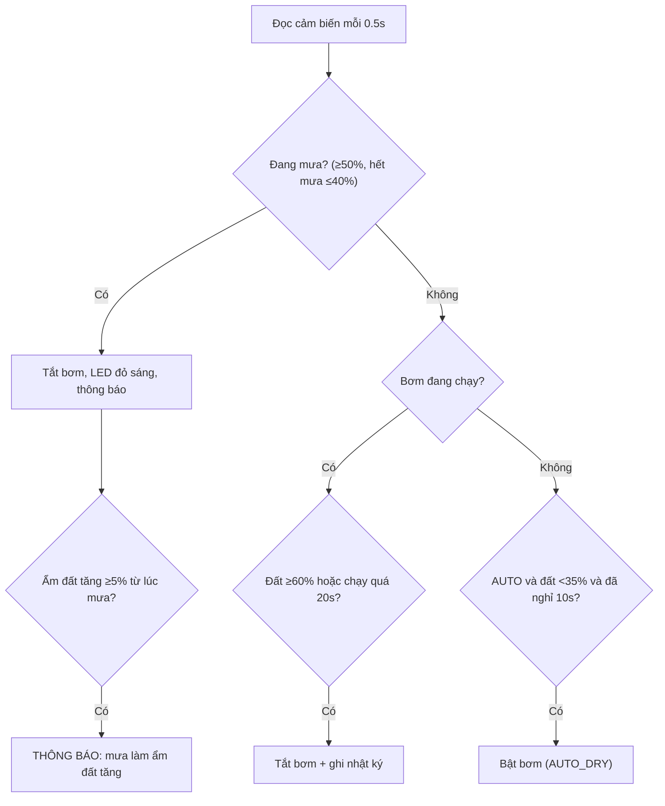

# Demo hệ thống tưới cây tự động – bản tinh gọn

> Phạm vi bản demo: **ESP32 + Wokwi (VS Code)**, chưa làm Web/Azure/MQTT.
> Lệnh Serial được thiết kế sẵn để sau này nối thẳng sang MQTT/Dashboard.

## 1. Đề bài sau khi tinh gọn

| Yêu cầu đề | Bản demo đáp ứng |
|---|---|
| Độ ẩm đất | Biến trở `potSoil` → GPIO34 (thật: cảm biến điện dung) |
| Cảm biến mưa + thông báo khi mưa làm ẩm đất tăng | Biến trở `pot1` → GPIO35 (thật: module mưa AO cấp 3,3V) |
| ≥ 2 cảm biến | Đất + Mưa + DHT22 (nhiệt độ/ẩm không khí, chỉ hiển thị) |
| Bơm/relay mô phỏng | Relay GPIO26 đóng xung GPIO18 đến A4988/stepper: quay = bơm chạy, dừng = bơm tắt |
| Tự động & thủ công | Công tắc GPIO25 (AUTO/MANUAL) + nút GPIO33 (bơm tay) |
| Nhật ký tưới | 10 lần gần nhất trong RAM, xem bằng lệnh `l` |
| LCD | LCD1602 I2C (SDA 21, SCL 22) |
| ≥ 2 thiết bị vào/ra | Vào: công tắc, nút. Ra: relay, LED đỏ, LCD |

Danh sách mua cho một ESP32 và sự khác nhau giữa mạch Wokwi và bơm DC thật: [MOT_ESP32_LINH_KIEN_VA_LOGIC.md](MOT_ESP32_LINH_KIEN_VA_LOGIC.md).

## 2. Logic điều khiển (toàn bộ nằm trong `control()` và `updateRain()`)

**Quy tắc an toàn áp dụng cho cả AUTO và MANUAL**: mưa → tắt; đất ≥ 60% → tắt; chạy quá thời gian tối đa → tắt.
MANUAL: nút/lệnh `p` bật–tắt bơm; bị từ chối nếu đang mưa hoặc đất đã đủ ẩm.
Đổi chế độ (công tắc hoặc lệnh `a`/`m`) luôn tắt bơm trước.

| Thông số | Wokwi | Phần cứng thật |
|---|---|---|
| Ngưỡng khô / đủ ẩm | 35% / 60% | 35% / 60% |
| Bơm chạy tối đa | 20 s | 60 s |
| Nghỉ giữa 2 lần AUTO | 10 s | 120 s |

## 3. Lệnh Serial (sau này = topic MQTT)

| Lệnh | Tác dụng |
|---|---|
| `a` / `m` | Chuyển AUTO / MANUAL |
| `p` | Bật/tắt bơm (chỉ MANUAL) |
| `s` | In một khối trạng thái nhiều dòng, tiếng Việt không dấu |
| `l` | In nhật ký tưới |
| `h` | Trợ giúp |

Serial in trạng thái khi khởi động, khi đổi chế độ/trạng thái bơm/mưa, khi gõ `s`, và nhắc lại mỗi 30 giây. Mỗi khối gồm đất, mưa, nhiệt độ, độ ẩm không khí, chế độ và bơm; thông báo bất thường dùng `[WARN]`. MQTT sẽ được bổ sung ở giai đoạn sau, không lấy nguyên văn khối Serial làm payload.

## 4. Ba kịch bản kiểm thử (`wokwi-scenarios/core.test.yaml`)

| # | Thao tác | Kết quả mong đợi |
|---|---|---|
| 1. AUTO | Vặn `potSoil` xuống 20% rồi lên 70% | `BOM BAT (AUTO_DRY)` → `BOM TAT (SOIL_WET)` |
| 2. MƯA | Đất 20% để bơm chạy, vặn `pot1` lên 80%, rồi tăng đất lên 30% | Bơm tắt vì `RAIN`; có `PHAT HIEN TROI MUA`, `MUA LAM DO AM DAT TANG`, `TROI DA TANH` |
| 3. MANUAL | Chuyển `m`, thử bật lúc đất 70%, giảm còn 50%, bật/tắt và gõ `l` | Từ chối khi đủ ẩm; `MANUAL_ON` → `MANUAL_OFF`, nhật ký có lần tưới |

## 5. Cách chạy

1. `Ctrl+Shift+B` (hoặc `scripts/build.ps1`) để build.
2. `F1` → **Wokwi: Start Simulator**.
3. Vặn 2 biến trở, gạt công tắc, nhấn nút; gõ lệnh trong Serial Monitor.

## 6. Bước tiếp theo (chưa làm)

- Wi-Fi + MQTT (chọn broker ở giai đoạn sau) → tạo payload riêng từ trạng thái cảm biến, nhận lệnh tương đương `a/m/p`.
- Dashboard (Node-RED hoặc Blynk) + lưu lịch sử.
- Lắp phần cứng thật, hiệu chuẩn `SOIL_RAW_*`, `RAIN_RAW_*` trong `main.cpp`.
