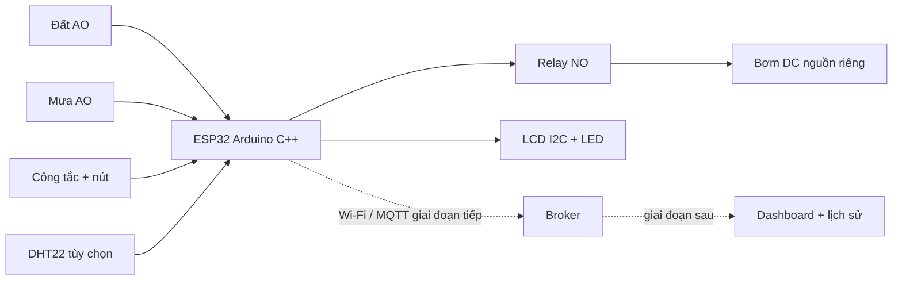

# Một ESP32 cho hệ thống tưới cây: linh kiện và logic

Cập nhật 14/10/2026. Tài liệu này bám theo `src/main.cpp`, `diagram.json` và cấu hình PlatformIO hiện tại. Ý tưởng tham khảo từ [smart-garden-iot](https://github.com/hkhuang07/smart-garden-iot) là cảm biến → ESP32 → MQTT → nơi lưu/hiển thị. Bản này dùng **một ESP32**, một vùng tưới và một bơm. Dashboard, cơ sở dữ liệu và Azure để giai đoạn sau.

## 1. Bộ mua cho một mô hình thật

| Thành phần | SL | Quyết định / giá hiển thị tham khảo |
|---|---:|---|
| ESP32 DOIT DevKit V1 hoặc NodeMCU-32S cổ điển | 1 | Chọn đúng board trước khi nạp. [NodeMCU-32S CH340: 179.000đ](https://icdayroi.com/kit-phat-trien-wifi-ble-esp32-nodemcu-32s-ch340). |
| Cảm biến độ ẩm đất điện dung, ngõ ra analog | 1 | [14.000đ](https://icdayroi.com/cam-bien-do-am-dat-dien-dung); cấp 3,3V, đo hai mốc khô/ướt trước khi dùng ngưỡng %. |
| Cảm biến mưa **có ngõ AO analog**, hoạt động với nguồn 3,3V | 1 | GPIO35 cần AO trong khoảng 0–3,3V. [Ví dụ loại AO/DO 3,3–5V](https://www.arduinovina.com/cam-bien-mua); giá và tồn kho cần hỏi lại. Tấm mưa dễ bị ăn mòn khi để ướt liên tục. |
| Relay bơm 1 kênh 5V, kích mức thấp | 1 | [15.000đ](https://icdayroi.com/module-1-relay-5v-kich-muc-thap). Cần tầng kích phù hợp 3,3V và trạng thái OFF lúc khởi động; xem sơ đồ điện trước khi lắp. |
| Transistor NPN P2N2222A + điện trở 2,2kΩ, 10kΩ, 4,7kΩ | 1 bộ | Kéo chân IN relay xuống LOW khi GPIO26 HIGH; 10kΩ giữ transistor OFF lúc ESP32 khởi động. Đối chiếu chân transistor và dòng IN theo món thật. |
| LCD1602 **đã có I2C** | 1 | Giữ màn hình của demo: [49.000đ](https://icdayroi.com/lcd-1602-tich-hop-san-module-chuyen-doi-i2c). Bản 5V cần chuyển mức I2C 3,3↔5V. |
| Module chuyển mức I2C hai chiều 3,3↔5V | 1 | Cần khi dùng LCD I2C 5V; kiểm tra pull-up có sẵn trên module/LCD. |
| Công tắc AUTO/MANUAL, nút bơm tay, LED đỏ và điện trở | Mỗi loại 1 | Đầu vào/ra tại chỗ; lấy cùng một bộ vật tư dây và nút. |
| Bơm DC, adapter, buck 5V, ống, bình nước, cầu chì, diode dập xung, dây công suất | 1 bộ | Chọn **một điện áp bơm** và nguồn theo nhãn/dòng khởi động thực tế. [Trang bơm 40.000đ](https://icdayroi.com/bom-nuoc-5v) ghi tên 5V nhưng thông số 12V; chưa dùng trang này để chốt điện áp hoặc adapter. |
| DHT22 | 0 hoặc 1 | Tùy chọn cho phần cứng thật vì đất + mưa đã là 2 cảm biến. Nếu muốn số nhiệt độ/ẩm trên LCD/Serial: [70.000đ](https://icdayroi.com/cam-bien-nhiet-do-do-am-dht22). Firmware vẫn chạy nếu chưa gắn, giá trị DHT sẽ là `null`. |

Bốn món có giá rõ trong bảng (ESP32, đất, relay, LCD) cộng **257.000đ**. Đây chỉ là tổng từng món tham khảo, **không phải giá cả bộ**: chưa gồm mưa AO, bơm, nguồn, chuyển mức, dây, bảo vệ, vận chuyển. Không mua thêm Arduino Uno, ESP32 thứ hai, LDR, pH, NPK, stepper hoặc A4988 cho mô hình thật. Stepper + A4988 chỉ là cách Wokwi hiện tại làm bơm chuyển động để quan sát.

**Không mua nhầm:** [cảm biến mưa 12V kèm relay](https://icdayroi.com/cam-bien-mua-kem-relay) trong dự toán cũ xuất ra tiếp điểm khô, không phải AO 3,3V mà firmware GPIO35 đang đọc. Nếu chọn loại 12V đó phải thiết kế lại đầu vào và logic mưa trước khi lắp; tuyệt đối không nối 12V vào GPIO35.

## 2. Một sơ đồ chức năng



| GPIO hiện tại | Vai trò | Wokwi | Mạch thật |
|---:|---|---|---|
| 34 | Độ ẩm đất | Biến trở `potSoil` | AO cảm biến đất, cấp 3,3V |
| 35 | Mưa | Biến trở `pot1` | AO cảm biến mưa, cấp 3,3V |
| 19 | Không khí | DHT22 | DHT22 tùy chọn |
| 25 / 33 | Điều khiển tại chỗ | Công tắc / nút | Công tắc / nút |
| 26 | Lệnh bơm | Relay NPN active HIGH | GPIO HIGH → transistor NPN dẫn → chân IN của relay 5V active LOW; tiếp điểm NO cấp nguồn bơm |
| 27 | Cảnh báo mưa | LED đỏ | LED đỏ qua điện trở |
| 21 / 22 | LCD | SDA / SCL | SDA / SCL qua chuyển mức nếu LCD 5V |
| 18 | Xung stepper | Chỉ Wokwi | **Không nối** khi dùng bơm DC |

Trong Wokwi, GPIO18 chỉ phát xung khi `pumpOn`, tiếp điểm relay COM–NO đóng và điện trở 10 kΩ kéo STEP của A4988 xuống GND khi NO mở. Điện trở này chỉ nằm ở mạch mô phỏng; diode dập xung của bơm DC thật không sửa được hiện tượng stepper mô phỏng quay khi OFF.

Không chạy dòng bơm qua breadboard, GPIO hoặc nguồn 3,3V của ESP32. Với bơm thật, kiểm tra nhãn, dòng khởi động, nguồn, dây, diode, cầu chì và tiếp điểm relay trước khi cấp điện. Sơ đồ phần cứng cũ trong `PHAN_CUNG_THUC_TE.md` thuộc một baseline khác (mưa số GPIO27, phao/STOP riêng); không dùng nguyên sơ đồ đó cho firmware/diagram hiện tại.

## 3. Nguồn và bảo vệ cần có khi dùng bơm thật

Nếu **bơm thực tế là loại 12V DC** và đã xác nhận dòng khởi động, dùng **một adapter 12V đủ dòng** rồi tách hai nhánh:

```text
Adapter 12V ── cầu chì nhánh bơm ── relay COM/NO ── bơm 12V
           └─ buck DC-DC 12V→5V ── ESP32 chân 5V, relay 5V, LCD 5V
ESP32 3V3 ── cảm biến đất/mưa 3,3V, DHT22 nếu lắp
GND các nhánh tín hiệu nối chung, dây dòng bơm đi riêng về nguồn
```

- **Cần buck hạ áp 12→5V** khi dùng chung adapter 12V; module LM2596 chỉnh 5,0V là một phương án. Không đưa 12V vào chân 5V/3V3 của ESP32 và không dùng điện trở hoặc diode nối tiếp để “hạ áp”. Board ESP32 đã có ổn áp 3,3V nên không cần mua thêm IC 3,3V nếu dòng cảm biến nằm trong khả năng board đã chọn. Kiểm tra điện áp đầu ra buck bằng đồng hồ trước khi gắn ESP32.
- **Không cần nguồn phụ thứ hai** cho bơm trong cấu hình một adapter đủ dòng. Nếu cấp ESP32 bằng USB khi thử riêng, bơm vẫn cần nguồn đúng điện áp; không đồng thời nối USB và 5V từ buck vào board khi chưa kiểm chứng mạch chọn nguồn/chống hồi dòng của đúng board.
- Relay module 5V phải có mạch kích và diode bảo vệ **cuộn relay** sẵn. Transistor NPN trong bảng chỉ điều khiển chân IN của module, không kéo motor hoặc cuộn relay trần. Bơm DC dạng tải cảm có thể cần **diode dập xung ở hai cực bơm**, vạch cathode về PUMP+, anode về PUMP−; chọn theo dòng bơm và xác nhận loại bơm có mạch điện tử tích hợp trước khi gắn. Diode cuộn relay không thay thế bảo vệ ở nhánh bơm.
- Cần cầu chì DC và dây/tiếp điểm relay chịu được dòng khởi động của bơm; giá trị cầu chì và adapter **chưa thể chốt** khi chưa có mã/nhãn bơm. Tụ lọc gần nhánh 5V và nhánh công suất giúp hạn chế sụt áp khi bật bơm, nhưng phải kiểm tra bằng phép đo dưới tải.

Nếu chọn **bơm 5V thật**, tính lại một phương án nguồn 5V đủ dòng và bỏ buck 12→5V; không dùng sơ đồ 12V trên cho bơm 5V. Trang bán bơm tham khảo đang ghi mâu thuẫn 5V/12V nên phải xin ảnh nhãn và thông số dòng trước khi mua.

## 4. Logic ngắn gọn trên ESP32

1. Đọc đất và mưa định kỳ. Đất dưới **35%** là khô; từ **60%** là đủ ẩm. Mưa bắt đầu ở **50%**, hết khi xuống **40%** để tránh chập chờn. Các phần trăm của mạch thật phải hiệu chuẩn từ ADC tại chỗ.
2. Đang mưa → tắt bơm ngay. Nếu trong mưa độ ẩm đất tăng thêm ít nhất **5 điểm phần trăm**, ghi thông báo. LED đỏ sáng khi mưa.
3. Đang bơm mà đất đạt **60%** hoặc hết thời gian tối đa → tắt. Giới hạn hiện tại: **20 giây Wokwi**, **60 giây phần cứng**. AUTO chỉ tưới lại sau thời gian nghỉ (**10 giây Wokwi**, **120 giây phần cứng**).
4. AUTO: đất dưới 35%, không mưa, đã nghỉ đủ → bật bơm. MANUAL: nút hoặc lệnh Serial chỉ bật khi không mưa và đất chưa đủ ẩm. Đổi chế độ luôn tắt bơm trước.
5. In trạng thái Serial thành từng dòng khi khởi động, có thay đổi chế độ/bơm/mưa, có lệnh `s`, và mỗi 30 giây; giữ 10 lượt tưới gần nhất trong RAM. Dữ liệu MQTT sẽ được định dạng riêng ở giai đoạn sau; lịch sử trong RAM mất khi mất điện. Điều khiển bơm chạy tại ESP32, không chờ kết nối mạng.

Lệnh Serial hiện tại: `a` AUTO, `m` MANUAL, `p` bật/tắt bơm tay, `s` trạng thái, `l` nhật ký. Chưa có kết nối MQTT trong firmware; khi làm truyền dữ liệu, giữ cùng quy tắc an toàn cho lệnh từ xa. Dashboard và lưu lịch sử lâu dài chưa triển khai.

## 5. Ba kịch bản bắt buộc

1. **AUTO khô → ẩm:** đất 20%, không mưa: bơm chạy; nâng đất lên 70%: bơm tắt với `SOIL_WET`.
2. **Mưa khi đang tưới:** đất khô làm bơm chạy; tăng mưa lên 80%: bơm tắt với `RAIN`; tăng đất thêm ít nhất 5% trong mưa: có thông báo.
3. **MANUAL:** chuyển chế độ; đất 70% thì lệnh bật bị từ chối; đất 50% thì bật/tắt bằng nút hoặc Serial và có nhật ký.

Chạy `wokwi-scenarios/core.test.yaml` hoặc làm tay trong Wokwi VS Code rồi ghi ảnh/log thật. Build và kiểm tra JSON chỉ chứng minh file hợp lệ, không chứng minh LCD/relay/bơm hiển thị đúng trong simulator hay mạch thật.
